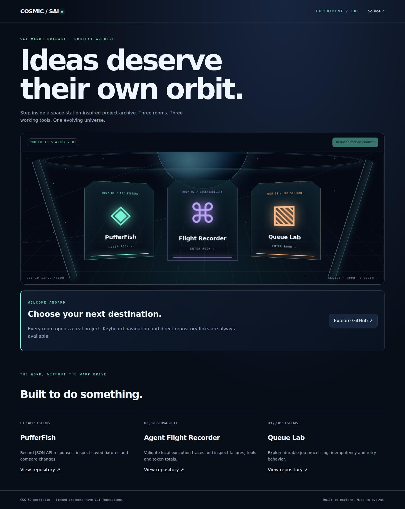

# Cosmic Portfolio

A space-station-inspired portfolio with CSS 3D project portals, illuminated holograms and an accessible project archive.

**Status:** working static prototype, no hosted deployment. See limitations below. This project uses no external assets, fonts, runtime dependencies, API keys or paid services.

## Quick start

Prerequisites: Python 3 for a local static server; Node.js 20+ for tests.

```bash
git clone https://github.com/manojPragada/cosmic-portfolio.git
cd cosmic-portfolio
python3 -m http.server 8000 --bind 127.0.0.1
```

Open http://127.0.0.1:8000. Keep the terminal running; Ctrl+C stops it. Serve over HTTP rather than opening index.html as a file because the app uses ES modules.

## Controls

Select a project portal to reveal its details and GitHub link. While a portal is focused, use Left/Right to move spatially between portals or Home/End to jump to the first/last portal; Enter opens the focused room. Use Previous/Next room to cycle destinations, Return to station or Escape to exit, and browser Back/Forward to retrace selections. A `?room=queue` URL opens a known room directly. Direction-aware light sweeps and nested corridor frames deepen room travel without delaying navigation. Modified clicks retain ordinary link behavior. Pause ambience stops decorative motion and camera transforms; reduced-motion preferences override all corridor animation, including changes made while the page is open. Conventional project links work without JavaScript.

## Project structure

```text
index.html         semantic document and conventional navigation
src/style.css      visual design, responsive and reduced-motion rules
src/app.js         DOM wiring and interaction lifecycle
src/model.js       pure state/data helpers
tests/            Node behavioral tests (directory:tests/)
ROADMAP.md         completed work and next priorities
.env.example       configuration notes
```

## Architecture and configuration

Vanilla ES modules keep the initial product runnable without a package install. The UI and pure model logic are separated. Relative asset URLs support hosting from a repository subdirectory. There are no environment variables or secrets; .env.example records this intentionally empty configuration contract.

## Verification



Preview: local synthetic/offline prototype, captured 2026-10-20; not a live service.

Browser regression checks (development only; Node.js 24 and npm):

```bash
npm ci --ignore-scripts
npx playwright install --with-deps chromium
npm test
npm run check
npm run test:browser
```

The browser runner manages its own loopback server and checks desktop (1440px), mobile (390px), keyboard skip navigation, horizontal overflow, page errors, reduced motion and core interactions. Screenshots go to ignored test-results/. Optional CHROMIUM_EXECUTABLE_PATH selects an existing Chromium; PLAYWRIGHT_MODULE_PATH selects an installed Playwright module. The CI workflow skips private repositories. This is focused regression coverage, not a comprehensive accessibility audit or live-provider verification. The static app still requires no package installation.

```bash
npm test
npm run check
```

Node's built-in test runner checks model behavior. The check script validates JavaScript syntax; it is not a linter or a browser accessibility audit. No production build step is needed. Desktop/mobile browser checks, if completed, are recorded in ROADMAP.md; do not infer browser coverage from unit tests alone.

## Accessibility and performance

Fine-pointer devices receive a subtle bounded perspective response and cursor-following station light. Wide, capable devices may also receive a dependency-free raw-WebGL depth starfield. It is created only at 800px+, with at least 4 GB device memory when that signal exists, WebGL support, and no reduced-motion preference. CSS stars are always the fallback. Pausing ambience stops rendering; project rooms remain ordinary links and the conventional archive remains available without JavaScript.

Semantic controls, visible keyboard focus, a skip link, responsive layouts and reduced-motion CSS are included. Decorative motion is pausable where present. No autoplay audio, analytics or external font requests. Browser-based interfaces require JavaScript except for the portfolio's conventional project links. An automated accessibility audit has not been completed.

## Data, assets and limitations

CSS perspective and transforms provide the navigable 3D illusion; optional raw WebGL adds decorative stars only, not a free-roaming camera or asset scene. Three linked project descriptions reflect their public repositories. No invented clients, qualifications or testimonials. React/TypeScript and imported 3D assets are not implemented; three clearly separated fictional design showcases are included as static examples.

All graphics and synthetic fixtures are original code in this repository. `examples/voltage/` is a clearly labelled fictional electric-motorcycle study; `examples/atelier/` is a fictional architecture-studio study. Their companies, products, projects and claims are not real. No third-party geographic dataset or media assets are bundled. No external API terms are relied upon in this prototype. Provider adapters will be documented and attributed before use.

## Deployment

The repository root is a static site. To publish on a static host, serve index.html with src/ at the same relative location and JavaScript files with an appropriate MIME type. No deployment has been performed or configured. Verify browser controls and data labels after deployment; do not add secrets to client code.

## Troubleshooting

- Blank page: use the HTTP server above, check browser console and confirm src/ is present.
- Port in use: select a different port, such as 8001.
- Tests unavailable: install Node.js 20+; there is no npm install step.
- Animation absent: check reduced-motion preferences and the pause control.
- Radio playback fails: use a direct playable HTTPS audio URL, not a webpage; network or codec support may prevent playback.

## Contributing

Use small, reviewable changes with a clear user benefit. Add model tests when behavior changes, run both verification commands, inspect desktop and mobile layouts, and update the roadmap and README. Use synthetic fixtures, preserve reduced-motion behavior and never commit secrets.

## License

A redistribution license has not yet been selected. Public visibility alone does not grant an open-source license.


